<div align="center">

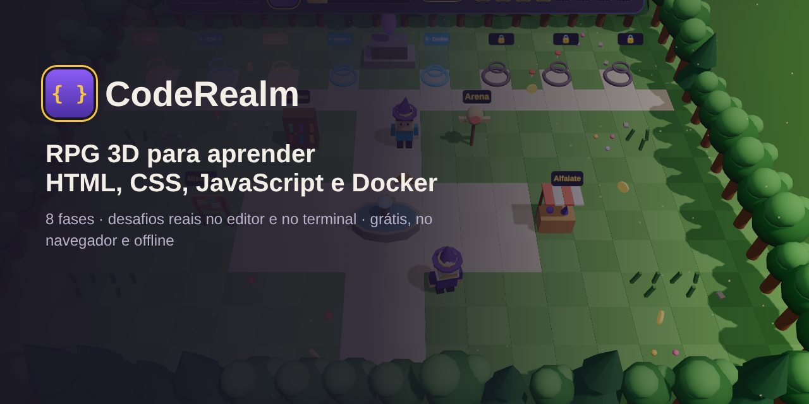

# CodeRealm

**RPG 3D no navegador para aprender HTML, CSS, JavaScript e Docker resolvendo desafios reais.**

Cada obstáculo do mapa é um conceito de programação. Você conversa com o mentor, entende o porquê, escreve o código (ou o comando) e vê o caminho se abrir.

[](https://github.com/breesiqueiramkt/coderealm/actions/workflows/ci.yml)
[](https://github.com/breesiqueiramkt/coderealm/actions/workflows/pages.yml)
[](LICENSE)


### [▶ Jogar agora](https://breesiqueiramkt.github.io/coderealm/) · [Documentação](docs/) · [Novidades](CHANGELOG.md)

</div>

---

## Sumário

- [O que é](#o-que-é)
- [Como é o jogo](#como-é-o-jogo)
- [Recursos](#recursos)
- [Começando](#começando)
- [Estrutura do projeto](#estrutura-do-projeto)
- [Arquitetura em 1 minuto](#arquitetura-em-1-minuto)
- [Qualidade: testes, lint e CI](#qualidade-testes-lint-e-ci)
- [Publicar no GitHub Pages](#publicar-no-github-pages)
- [Contribuindo](#contribuindo)
- [Roadmap](#roadmap)
- [Créditos e licença](#créditos-e-licença)

## O que é

O CodeRealm nasceu de uma pergunta simples: **e se aprender programação tivesse a sensação de explorar um RPG?** O jogo segue um ciclo pedagógico fixo em toda fase:

1. **Anomalia** — o caminho está bloqueado (ponte quebrada, rio sem plataformas, um goblin-bug solto na forja).
2. **Teoria** — um mentor explica o conceito em poucas falas: o quê, por quê e onde se usa de verdade.
3. **Desafio** — ao encostar no obstáculo abre um editor ou terminal. A resposta é validada de verdade: o CSS é medido na página renderizada, o JavaScript roda contra testes, o Docker é interpretado por um simulador.
4. **Recompensa** — o obstáculo se desfaz, você ganha XP, moedas, estrelas e um item.

É **gratuito, roda no navegador, funciona offline** e não precisa de instalação nem cadastro. O progresso fica salvo no próprio navegador.

## Como é o jogo

|       Academia do Código (mundo central)        |               Desafio de Docker no terminal                |
| :---------------------------------------------: | :--------------------------------------------------------: |
|   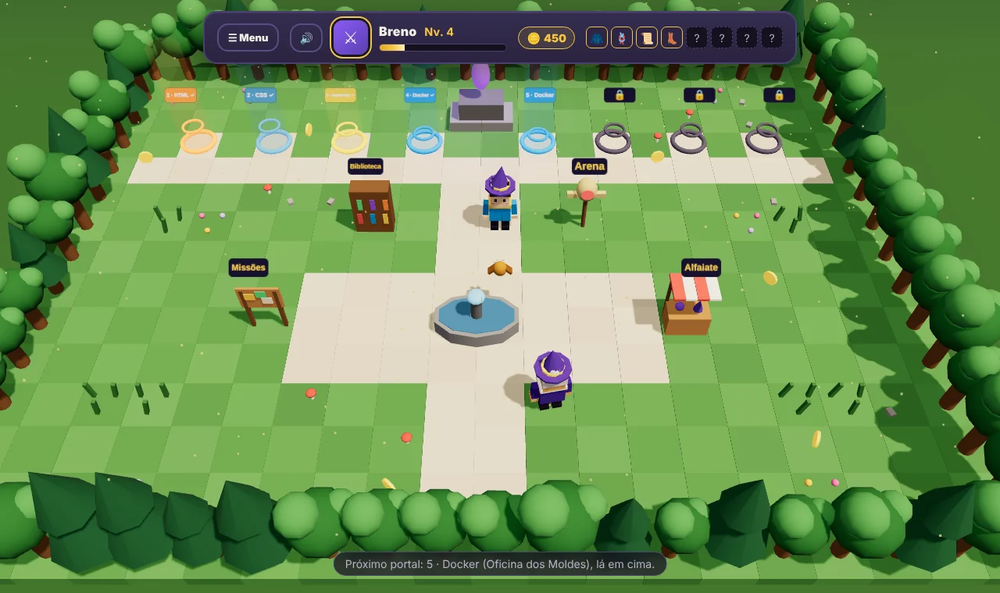   | 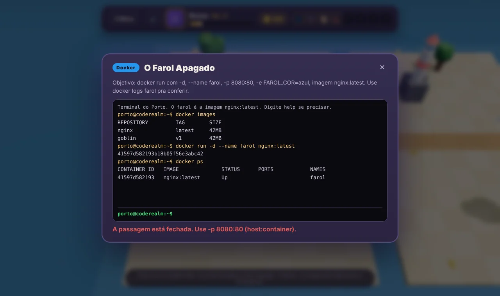 |
|      **Desafio de CSS com prévia ao vivo**      |                   **Personagem e loja**                    |
|    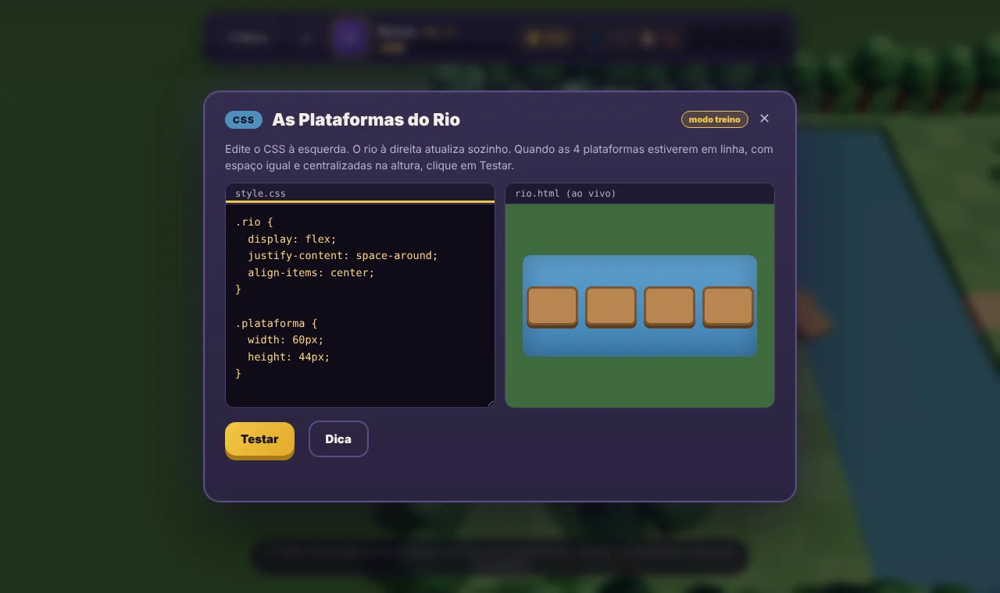    |      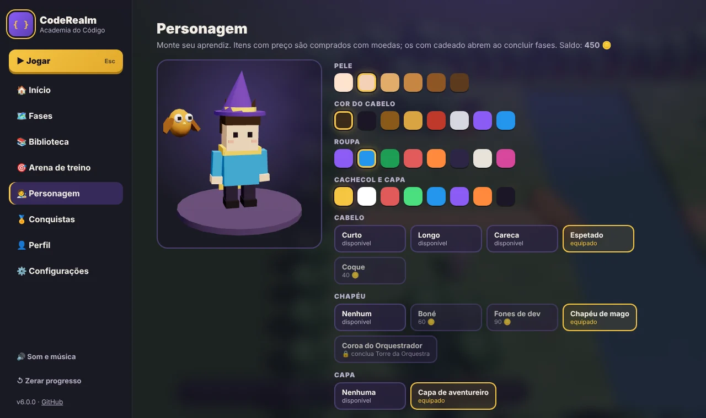       |
|      **Projeto real verificado na página**      |          **Certificado ao passar no Exame Final**          |
| 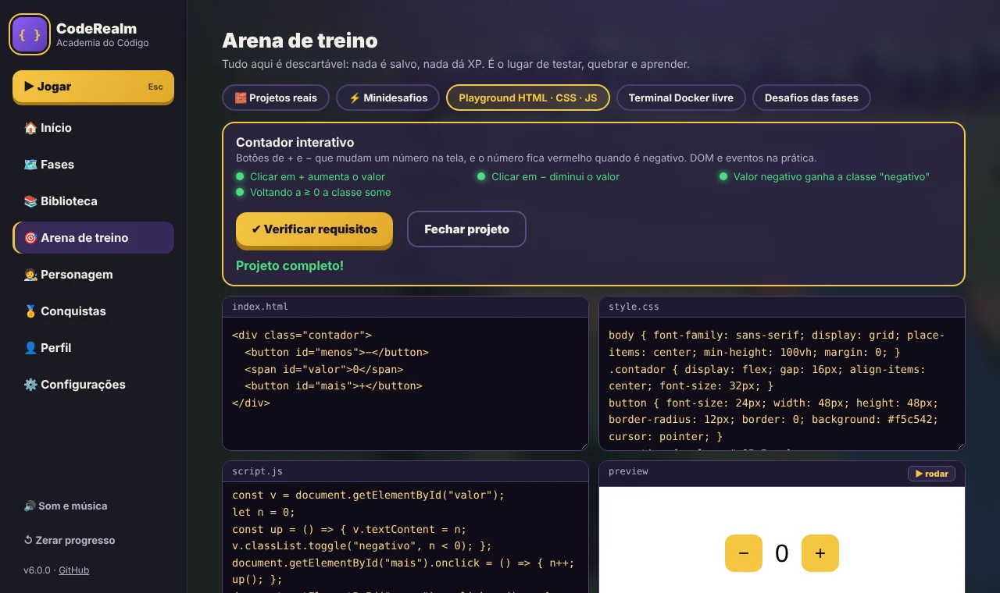 |     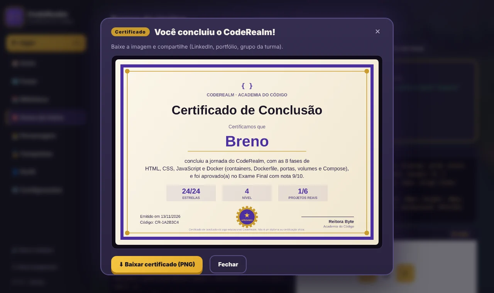      |

<details>
<summary>Mais imagens: menu, fase do Porto e celular</summary>

|                Menu                 |             Porto das Conexões             |                                Celular                                |
| :---------------------------------: | :----------------------------------------: | :-------------------------------------------------------------------: |
| 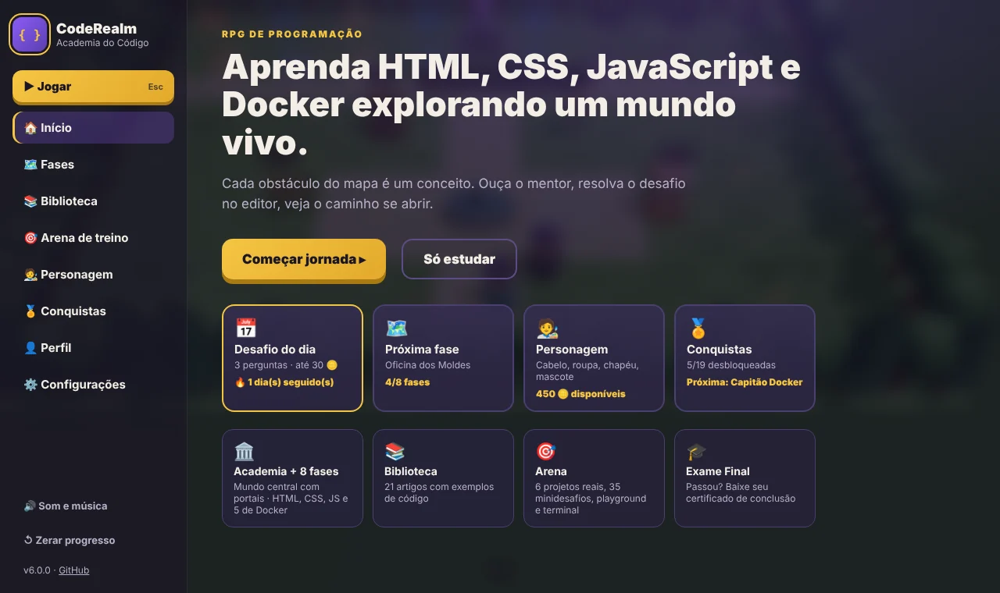 | 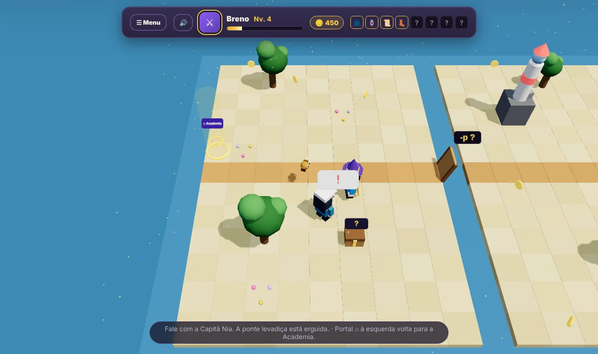 | 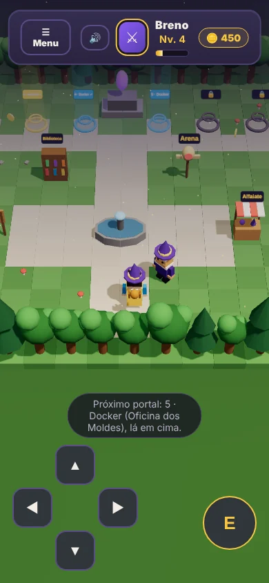 |

</details>

## Recursos

**Aprender**

- **8 fases** em sequência: tags HTML, Flexbox, variáveis e condicionais, containers, Dockerfile e build, portas e variáveis de ambiente, volumes, Docker Compose.
- **5 tipos de desafio**: montar a estrutura arrastando tags, editor de CSS com prévia ao vivo, editor de JavaScript com testes (rodando isolado num Web Worker), terminal Docker simulado e editor de arquivos (Dockerfile, `docker-compose.yml`) com checklist.
- **Biblioteca** com 21 artigos com exemplos (HTML, CSS, JavaScript, Docker e Git), busca e marcação de lidos.
- **Arena de treino**: 6 projetos reais (cartão de visita, menu responsivo, contador, lista de tarefas, painel com `fetch` e deploy com Docker), 35 minidesafios em 4 formatos, playground HTML/CSS/JS com console e terminal Docker livre. Nada ali vale nota: é para errar à vontade.
- **Exame Final** com 10 questões das quatro trilhas e **certificado de conclusão** em PNG para compartilhar.

**Jogar**

- **Mundo 3D** low-poly em Three.js: Academia central com portais para cada fase, 4 temas visuais, vento, água, lava, partículas.
- **Personagem customizável**: pele, cabelo, roupa, chapéu, capa e mascote que te segue.
- **Premiações**: moedas no mapa e em baús com tranca de código, 1 a 3 estrelas por fase (erro e dica contam), 19 conquistas, desafio do dia e sequência de dias seguidos.

**Para qualquer pessoa e qualquer máquina**

- **PWA**: instala como app e funciona sem internet depois da primeira visita.
- **Celular e tablet** com direcional na tela; câmera ajustada para tela em pé.
- **Acessibilidade**: movimento reduzido, velocidade do texto, navegação por teclado, foco visível, rótulos para leitor de tela.
- **Qualidade gráfica automática**: baixa sozinha em PC fraco. Sem WebGL, Biblioteca e Arena continuam funcionando.
- **Save robusto**: cópia de segurança automática e exportar/importar em arquivo.

## Começando

### Só jogar

Acesse **https://breesiqueiramkt.github.io/coderealm/**. Para instalar como app, use "Instalar" na barra de endereço (Chrome/Edge) ou "Adicionar à tela de início" (celular).

### Rodar no seu computador

Não há etapa de build. Duas opções:

```bash
# 1) Mais simples: baixe o projeto e dê dois cliques em index.html.

# 2) Com servidor local (necessário para testar o modo offline/PWA):
git clone https://github.com/breesiqueiramkt/coderealm.git
cd coderealm
npm start            # abre em http://localhost:8080
```

### Para desenvolver

Requisitos: **Node.js 20+** (recomendado 22, veja `.nvmrc`).

```bash
npm install                       # ferramentas de desenvolvimento (ESLint, Prettier, Playwright)
npx playwright install chromium   # navegador dos testes (uma vez só)

npm start            # servidor local em http://localhost:8080
npm run check        # lint + formatação + testes unitários (rode antes de cada commit)
npm run test:e2e     # testes no navegador, jogando de verdade
npm run format       # formata o código com Prettier
npm run screenshots  # regenera as imagens desta página
```

## Estrutura do projeto

```
coderealm/
├── index.html              # página única; a ordem dos <script> importa
├── manifest.webmanifest    # PWA: nome, ícones, cores
├── sw.js                   # service worker: cache para jogar offline
├── src/
│   ├── core/               # boot e erros, configurações, estado + save + regras do grid
│   ├── content/            # DADOS: fases, mapas, artigos, minidesafios, projetos, itens, conquistas
│   ├── systems/            # áudio, simulador de Docker, premiações, minidesafios, exame/certificado
│   ├── ui/                 # diálogo e desafios, menu (hub), controles de toque
│   ├── engine/             # renderização 3D (world.js) e loop do jogo (game.js)
│   └── styles/main.css
├── vendor/three.min.js     # Three.js r147 (MIT), embutido para funcionar offline
├── assets/                 # ícones e imagem de capa
├── tests/
│   ├── unit/               # node:test — conteúdo, mapas jogáveis, regras, save, simulador Docker
│   └── e2e/                # Playwright — joga o jogo inteiro num Chromium sem janela
├── scripts/                # servidor local, gerador de ícones e de screenshots
├── docs/                   # arquitetura, guia de conteúdo, design, roadmap
└── .github/                # CI, deploy no Pages, templates de issue e PR
```

> Quer adicionar uma fase, um artigo ou um minidesafio? É quase sempre só editar um arquivo em `src/content/`. O passo a passo está em [docs/CONTEUDO.md](docs/CONTEUDO.md).

## Arquitetura em 1 minuto

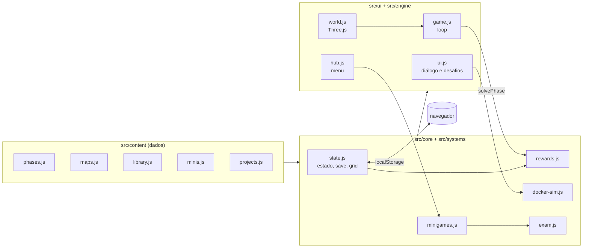

- **Sem bundler, de propósito.** Scripts clássicos compartilham o escopo global e são carregados em ordem pelo `index.html`. O jogo abre com duplo clique, o código é lido como está e o deploy é copiar arquivos. O custo (globais) é compensado pela organização em camadas e por um ESLint que descobre automaticamente os nomes compartilhados entre arquivos.
- **Dados separados da engine.** Fases, mapas e textos não importam Three.js, e por isso os testes rodam em Node puro.
- **Desempenho.** Chão, árvores, pedras e flores são `InstancedMesh` (cerca de 80 draw calls por mapa); o mundo para de desenhar com o menu aberto; a qualidade cai sozinha abaixo de 24 fps.

Detalhes em [docs/ARQUITETURA.md](docs/ARQUITETURA.md).

## Qualidade: testes, lint e CI

|                                                 | O que garante                                                                                                                                                                                                                                                                                                             |
| ----------------------------------------------- | ------------------------------------------------------------------------------------------------------------------------------------------------------------------------------------------------------------------------------------------------------------------------------------------------------------------------- |
| **147 testes unitários** (`npm test`)           | Todo mapa tem 20×15, nenhuma fase pode ser "pulada" (busca em largura do spawn até a saída), moedas e baús alcançáveis, cada minidesafio tem resposta coerente, regras de estrela/moeda/sequência/loja, save, backup e migração de saves antigos, simulador de Docker e o gabarito de cada fase de terminal e de arquivo. |
| **11 testes no navegador** (`npm run test:e2e`) | Abre o jogo num Chromium e joga: tutorial, Academia, Reitora, portais, **as 8 fases pela interface**, projeto real, configurações após recarregar, Exame + certificado, celular com toque, **modo offline (PWA)** e o comportamento sem WebGL.                                                                            |
| **ESLint + Prettier**                           | Estilo único e erros comuns barrados antes do commit.                                                                                                                                                                                                                                                                     |
| **GitHub Actions**                              | Cada push e pull request roda tudo acima. A `main` só é publicada se os testes passarem.                                                                                                                                                                                                                                  |

Os testes já pegaram bugs reais. Um exemplo: na Fase 4, quem rodava `docker run -d goblin:v1` antes do comando certo ficava travado, porque o jogo olhava só o primeiro container.

## Publicar no GitHub Pages

O workflow `.github/workflows/pages.yml` publica automaticamente a cada push na `main`. **Configuração única:**

1. No repositório: **Settings → Pages**.
2. Em **Build and deployment → Source**, escolha **GitHub Actions**.
3. Faça um push (ou rode o workflow em **Actions → Deploy (GitHub Pages) → Run workflow**).

O jogo fica em `https://breesiqueiramkt.github.io/coderealm/`. Ao lançar versão nova, troque `CACHE` em `sw.js` para os jogadores receberem a atualização.

## Contribuindo

Contribuições são bem-vindas: código, conteúdo, correções de texto, ideias. Leia o [CONTRIBUTING.md](CONTRIBUTING.md) e o [Código de Conduta](CODE_OF_CONDUCT.md). Em resumo:

1. Faça um fork e crie uma branch (`git switch -c feat/minha-ideia`).
2. Rode `npm run check` e `npm run test:e2e`.
3. Abra um pull request explicando o que muda e por quê.

## Roadmap

- [x] 8 fases (HTML, CSS, JavaScript, Docker), Biblioteca, Arena, projetos reais
- [x] Academia como mundo central com portais
- [x] Personagem, loja, conquistas, estrelas, desafio do dia
- [x] Exame Final e certificado, PWA offline, celular, acessibilidade
- [ ] Mundo aberto: áreas conectadas sem tela de transição
- [ ] Modelos 3D (glTF) e animações no lugar das formas geométricas
- [ ] Trilhas novas: Git na prática, APIs REST com Node, SQL
- [ ] Contas e ranking da turma (backend opcional)
- [ ] Modo professor: acompanhar o progresso de uma turma

Roadmap completo em [docs/ROADMAP.md](docs/ROADMAP.md).

## Créditos e licença

Criado por **Breno** ([BsCode](https://github.com/breesiqueiramkt)), estudante de Desenvolvimento de Software Multiplataforma na Fatec Jacareí.

- Código sob a licença [MIT](LICENSE).
- [Three.js](https://threejs.org) (MIT) e as fontes Nunito e JetBrains Mono (SIL OFL) — veja [THIRD_PARTY_NOTICES.md](THIRD_PARTY_NOTICES.md).
- Projeto _clean-room_: inspirado na sensação de RPGs clássicos de visão de cima, sem nenhum asset, nome, código ou história de jogos existentes. Todo o visual é desenhado por código.
