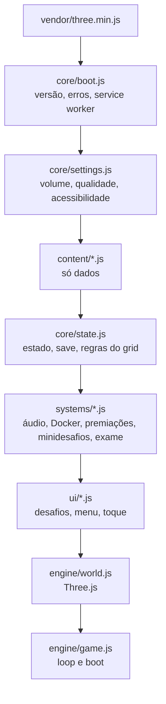

# Arquitetura

Este documento explica como o CodeRealm está organizado por dentro: por que não há build, como os arquivos se conversam, como o estado é salvo, como o 3D é desenhado e como cada desafio é validado.

## Decisão principal: scripts clássicos, sem bundler

O `index.html` carrega cerca de 20 arquivos com `<script src>` comuns, **em ordem**. Scripts clássicos compartilham o escopo global: um `const PHASES` declarado em `src/content/phases.js` pode ser usado em `src/ui/ui.js`, desde que este venha depois.

| Por que assim                                                                  | O que isso custa                                   | Como compensamos                                                                                                  |
| ------------------------------------------------------------------------------ | -------------------------------------------------- | ----------------------------------------------------------------------------------------------------------------- |
| Abre com duplo clique no `index.html` (ES modules não funcionam em `file://`). | Nomes globais podem colidir.                       | Camadas bem definidas, um módulo por arquivo (`const Rewards = (() => { ... })()`) e nomes descritivos.           |
| Quem está aprendendo lê o código exatamente como ele roda.                     | O ESLint não "enxerga" o que vem de outro arquivo. | `eslint.config.js` lê cada arquivo com o parser do ESLint e libera, para cada um, os nomes declarados nos outros. |
| Deploy é copiar arquivos (GitHub Pages, qualquer hospedagem).                  | Sem tree-shaking ou minificação.                   | O jogo inteiro tem cerca de 1 MB, 600 KB dos quais são do Three.js.                                               |

Se um dia o projeto precisar de bundler (TypeScript, por exemplo), a separação em camadas abaixo facilita a migração: cada arquivo já tem uma responsabilidade única.

## Camadas e ordem de carregamento



Regra de dependência: um arquivo pode **usar em tempo de execução** qualquer coisa já carregada, e pode **chamar** funções de arquivos posteriores somente dentro de funções (que rodam depois do boot). O único código que roda no carregamento e depende de tudo é o bloco "Boot" no fim de `engine/game.js`.

| Pasta     | Arquivo                                   | Responsabilidade                                                                                   |
| --------- | ----------------------------------------- | -------------------------------------------------------------------------------------------------- |
| `core`    | `boot.js`                                 | `APP_VERSION`, barra de erro amigável, registro do service worker                                  |
|           | `settings.js`                             | Configurações do jogador (salvas à parte do progresso) e presets de qualidade                      |
|           | `state.js`                                | `state`, `save()`, `load()`, backup, `isBlocked()`, portais, quiosques, desbloqueio, moedas e baús |
| `content` | `phases.js`                               | As 8 fases: mentor, falas, desafio, validação, recompensa                                          |
|           | `maps.js`                                 | Grades 20×15, Academia, portais, quiosques, guia (Reitora)                                         |
|           | `library.js` · `minis.js` · `projects.js` | Artigos, banco de minidesafios, projetos reais                                                     |
|           | `cosmetics.js` · `achievements.js`        | Itens da loja e conquistas                                                                         |
| `systems` | `audio.js`                                | Música e efeitos com Web Audio (sem arquivos de áudio)                                             |
|           | `docker-sim.js`                           | Simulador de Docker puro (sem DOM): recebe texto, devolve linhas                                   |
|           | `rewards.js`                              | Moedas, estrelas, sequência diária, conquistas, loja                                               |
|           | `minigames.js` · `exam.js`                | Motor dos minidesafios; Exame Final e certificado em canvas                                        |
| `ui`      | `ui.js`                                   | Diálogo, modal e os 5 tipos de desafio                                                             |
|           | `hub.js` · `touch.js`                     | Menu (todas as páginas) e controles de toque                                                       |
| `engine`  | `world.js`                                | Renderer, materiais, personagens, temas, mapa instanciado, obstáculos, portais                     |
|           | `game.js`                                 | Movimento, interação, recompensa, HUD, loop e boot                                                 |

## Estado e save

Todo o progresso vive num único objeto, `state` (`src/core/state.js`). A lista `PERSIST` define o que vai para o `localStorage`:

```js
{ version: 3, schema: 6, savedAt: '...', pos: { x, y }, map, done, stars, coins, look, ... }
```

- **Compatibilidade:** `applySave()` mescla objetos com os valores padrão. Um save antigo, sem os campos novos, ganha os padrões em vez de quebrar. A chave continua `coderealm:save:v3` para não perder o progresso de quem já jogava.
- **Backup:** `saveBackup()` grava uma cópia em `coderealm:save:v3:backup` em marcos (fase concluída, troca de mapa, exame). Se o save principal estiver corrompido, `load()` tenta o backup.
- **Configurações** ficam em `coderealm:settings`: zerar o progresso não apaga volume nem acessibilidade.
- **Migração de economia:** `Rewards.migrate()` dá 2 estrelas e 40 moedas para fases concluídas antes da existência de estrelas.

## O grid e a interação

O mundo é uma grade de 20×15. `isBlocked(x, y)` é a única fonte de verdade sobre o que existe em uma célula:

| Retorno      | Significado                | O que acontece ao encostar (ou apertar E)   |
| ------------ | -------------------------- | ------------------------------------------- |
| `false`      | livre                      | anda                                        |
| `true`       | parede, água, árvore, lava | nada                                        |
| `'npc'`      | mentor ou Reitora          | diálogo                                     |
| `'obstacle'` | obstáculo da fase          | abre o desafio                              |
| `'chest'`    | baú                        | minidesafio da trilha                       |
| `'prop'`     | quiosque da Academia       | Exame, Missões, Alfaiate, Biblioteca, Arena |
| `'locked'`   | portal trancado            | aviso de qual fase falta                    |

Portais são células andáveis: ao chegar em uma, `onArrive()` chama `changeMap(destino)`.

## Renderização

- **Instâncias.** `buildWorld()` percorre a grade, junta as matrizes de tudo que se repete (tiles, troncos, copas, pedras, flores) e cria um `InstancedMesh` por tipo: cerca de 80 draw calls por mapa, contra ~500 se cada tile fosse um objeto. O vento recalcula as matrizes das copas a cada frame com `setMatrixAt`.
- **Personagens** são montados com caixas, cones e esferas em `makeCharacter(look)`; o mesmo código desenha herói, mentores e a prévia da loja.
- **Economia de GPU:** com o menu aberto o loop só desenha quando `needsFrame` é verdadeiro; com um desafio aberto, desenha 1 de cada 3 frames.
- **Qualidade:** presets em `QUALITY_PRESETS` (sombras, resolução, partículas). No modo `auto`, se a média ficar abaixo de 24 fps nos primeiros segundos, cai para `baixa`.
- **Sem WebGL:** o renderer é criado num `try/catch`. Se falhar, `HAS_WEBGL = false`, o botão de jogar é desativado com explicação, e o resto do app continua funcionando.

## Como cada desafio é validado

| Tipo           | Validação                                                                                                 | Onde                    |
| -------------- | --------------------------------------------------------------------------------------------------------- | ----------------------- |
| `dragdrop`     | Compara cada encaixe com `answer`; a dica explica o primeiro erro                                         | `ui.js › buildDragDrop` |
| `css`          | Injeta o CSS num `iframe` e lê `getComputedStyle()`: valida o resultado, não o texto                      | `ui.js › buildCss`      |
| `js`           | Roda o código num **Web Worker** com limite de 2 s (loop infinito não trava o jogo) e compara com `tests` | `ui.js › runTests`      |
| `terminal`     | `DockerSim` interpreta o comando; `check(docker)` da fase olha o estado resultante                        | `systems/docker-sim.js` |
| `file`         | Cada regra (`rules[].test`) recebe as linhas do arquivo                                                   | `ui.js › buildFile`     |
| Projetos reais | Cada requisito clica, envia formulários e mede estilos no `iframe` renderizado                            | `content/projects.js`   |

Estrelas: `ui.js` conta erros (`feedback` negativo) e dicas; `Rewards.starsFor(erros, dicas)` decide (3 = nada; 2 = até 2 erros ou alguma dica; 1 = o resto).

## PWA

`sw.js` guarda no cache os arquivos listados em `SHELL` na instalação. Arquivos do próprio site usam _cache primeiro_; fontes do Google usam _rede primeiro_, com o cache como reserva. Ao publicar uma versão, mude `CACHE` para os jogadores baixarem a nova. O registro (em `boot.js`) só acontece em `http(s)`: aberto por `file://`, o jogo funciona normalmente, só sem o modo offline.

## Testes

- **Unitários** (`tests/unit`, `node:test`): `tests/helpers/load.js` carrega os scripts do navegador dentro de um contexto `vm` do Node, com dublês para DOM, áudio e UI. Testam dados, regras e o simulador sem abrir navegador.
- **Ponta a ponta** (`tests/e2e`, Playwright): sobem `scripts/serve.js` numa porta livre e jogam no Chromium com WebGL por software (SwiftShader). Por velocidade, a maioria desliga o desenho 3D (`renderer.render = () => {}`), mantendo toda a lógica.
