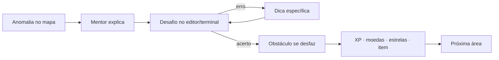

# Design de jogo e pedagogia

## Princípios

1. **O conceito é o obstáculo.** Não existe pergunta solta: a ponte está quebrada _porque_ falta estrutura HTML; o rio não tem passagem _porque_ as plataformas não estão alinhadas.
2. **Teoria curta, prática imediata.** O mentor fala o essencial (o quê, por quê, como), e o desafio vem na hora, enquanto a explicação está fresca.
3. **Validação de verdade.** O jogo mede o resultado como um computador mediria: estilo computado, testes de função, estado de containers. Não aceita "parecido".
4. **Errar é parte do jogo.** Dicas progressivas, mensagens de erro traduzidas, Arena sem nota. A recompensa por acertar de primeira (3 estrelas) existe, mas repetir para melhorar também paga.
5. **Clean-room.** Inspirado na sensação de RPGs clássicos de visão de cima (grid, NPCs, missões), sem nenhum asset, nome ou história de jogos existentes.

## Ciclo de cada fase

## Trilha atual

| #   | Área                 | Conceito                            | Desafio                                       |
| --- | -------------------- | ----------------------------------- | --------------------------------------------- |
| 1   | Vale das Tags        | Estrutura HTML e semântica          | Montar a ponte encaixando tags                |
| 2   | Rio Flexível         | Box Model e Flexbox                 | Alinhar plataformas com CSS                   |
| 3   | Portão dos Oráculos  | Variáveis e condicionais            | Completar uma função e passar nos testes      |
| 4   | Forja dos Containers | Imagem e container, `docker run`    | Prender o goblin-bug num container            |
| 5   | Oficina dos Moldes   | Dockerfile, camadas, `docker build` | Escrever o Dockerfile, construir e subir      |
| 6   | Porto das Conexões   | Portas (`-p`) e variáveis (`-e`)    | Acender o farol publicando a porta            |
| 7   | Cofre das Memórias   | Volumes e persistência              | Provar que os dados sobrevivem ao container   |
| 8   | Torre da Orquestra   | Docker Compose                      | Escrever o compose (api + banco) e subir tudo |

## Economia de recompensas

| Fonte             | Moedas                       |
| ----------------- | ---------------------------- |
| Moeda no chão     | 5                            |
| Baú (minidesafio) | 25                           |
| Fase              | 20 por estrela nova (até 60) |
| Desafio do dia    | 10 por acerto (até 30)       |
| Dias seguidos     | 10 × dias (até 70)           |
| Projeto real      | 40 a 120                     |
| Conquista         | 10 a 100                     |
| Exame Final       | 100                          |

Estrelas: 3 = sem erros e sem dicas; 2 = até 2 erros ou com dica; 1 = concluiu. Itens da loja custam de 40 a 300 moedas, ou seja, uma partida completa compra quase tudo, mas não tudo: há motivo para repetir fases e fazer projetos.

## Direção de arte

- **Low-poly desenhado por código.** Tudo é feito de caixas, cones e esferas com cores sólidas, o que mantém o projeto 100% original e leve.
- **Paleta "Cozy Academic":** roxo-mágico `#8b5cf6`, dourado de XP `#f5c542`, verde-musgo, madeira, e um tema por área (forja quente, porto claro, cofre lilás).
- **Cada trilha tem uma cor:** HTML laranja, CSS azul, JavaScript amarelo, Docker azul-Docker. A cor aparece nos portais, nas partículas e nos cards.
- **Vida no cenário:** copas balançando, grama, água, lava pulsando, partículas de "dados" no ar, poeira nos pés.

## Acessibilidade

- Movimento reduzido (respeita a preferência do sistema): sem balanço, partículas ou zoom.
- Velocidade do texto ajustável, inclusive instantânea.
- Tudo do menu funciona por teclado, com foco visível e link "pular para o conteúdo".
- Diálogos, avisos e terminal anunciados para leitores de tela (`role`, `aria-live`).
- Controles de toque grandes no celular, ativáveis manualmente em qualquer dispositivo.
